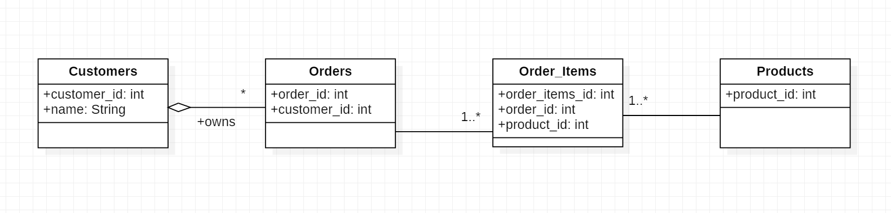

## C2: Building the Databases *ECOMMERCE_DB* and *FREERIDER_DB*
<!-- - - - - - - - - - - - - - - - - - - - - - - - - - - - - - - - - - - - -->
The exercise creates two databases, one *ECOMMERCE_DB* with *CUSTOMERS*,
*PRODUCTS* and *ORDERS* to understand building a realistic database from
a given schema and data-set. Building and running queries is demonstrated
as well.

The second part designs the *FREERIDER_DB* database based on the vehicle
reservation business process with:

- *Logical design* - with the design of the database schema graphically
    as *ER-Diagram* and as *SQL schema*.

- *Technical design* - understand the technical environment with the
    *mysqld* database server running in a Docker container and the
    *FREERIDER_DB* schema baked into a Docker image.

Steps:

1. [Building Database *ECOMMERCE_DB* with *Customers* and *Orders*](#1-building-database-ecommerce_db-with-customers-products-and-orders)


    - 1.1 [Re-engineer the *ER-Diagram* from the *DB-Schema*](#11-re-engineer-the-er-diagram-from-the-db-schema)

    - 1.2 [Understand the *Schema*](#12-understand-the-schema)

    - 1.3 [*Schema-Load*](#13-schema-load)

    - 1.4 [*Data-Load*](#14-data-load)

    - 1.5 [*Building* and *Running* *Queries*](#15-building-and-running-queries)

    - 1.6 [Connecting *VSCode* to the Database](#16-connecting-vscode-to-the-database)


&nbsp;

2. [*Logical* and *Technical Design* of the *FREERIDER_DB* Database](#2-logical-and-technical-design-of-the-freerider_db-database)


    - 2.1 [Logical Design of the *FREERIDER_DB* Database](#21-logical-design-of-the-freerider_db-database)

    - 2.2 [Schema Design of the *FREERIDER_DB* Database](#22-schema-design-of-the-freerider_db-database)

    - 2.3 [Technical Design of the *FREERIDER_DB* Database](#23-technical-design-of-the-freerider_db-database)

    - 2.4 [Build the *FREERIDER_DB* Docker Image](#24-build-the-freerider_db-docker-image)

    - 2.5 [Create and Mount *Volume*](#25-create-and-mount-volume)

    - 2.6 [*Data-Load*](#26-data-load)

    - 2.7 [*Building* and *Running* *Queries*](#27-building-and-running-queries)


<!-- - - - - - - - - - - - - - - - - - - - - - - - - - - - - - - - - - - - -->

&nbsp;

## 1. Build Database *ECOMMERCE_DB* with *CUSTOMERS*, *PRODUCTS* and *ORDERS*

Build another database: *"ECOMMERCE_DB"* in the *mysqld-container* from a given
schema: [*e-commerce-db-schema.sql*](e-commerce-db-schema.sql) with four
*entity types* (tables):

* *CUSTOMERS* with customer information.

* *PRODUCTS* with product information.

* *ORDERS* with items ordered by a customer.

* *ORDER_ITEMS* as quantities of ordered products included in an order.

The figure shows the relationships between entity types:




&nbsp;

Steps:


<!-- - - - - - - - - - - - - - - - - - - - - - - - - - - - - - - - - - - - -->

&nbsp;

### 1.1 Re-engineer the *ER-Diagram* from the *DB-Schema*

Re-engineer the *ER-Diagram* with the four entity types from the schema
including relations and cardinalities:
[*e-commerce-db-schema.sql*](e-commerce-db-schema.sql) -
draw an *ER-Diagram*.


<!-- - - - - - - - - - - - - - - - - - - - - - - - - - - - - - - - - - - - -->

&nbsp;

### 1.2 Understand the *Schema*

Consider fragment:

```sql
 1:  CREATE TABLE CUSTOMERS (
 2:      customer_id INT UNSIGNED AUTO_INCREMENT PRIMARY KEY,
 3:      first_name VARCHAR(50) NOT NULL,
 4:      last_name VARCHAR(50) NOT NULL,
 5:      email VARCHAR(255) NOT NULL UNIQUE,
 6:      phone VARCHAR(20),
 7:      shipping_address TEXT,
 8:      billing_address TEXT,
 9:      created_at TIMESTAMP DEFAULT CURRENT_TIMESTAMP,
10:      updated_at TIMESTAMP DEFAULT CURRENT_TIMESTAMP ON UPDATE CURRENT_TIMESTAMP,
11:      
12:      INDEX idx_customer_email (email),
13:      INDEX idx_customer_name (last_name, first_name)
14:  );
```

Answer questions:

1. What is: `UNSIGNED` in line 2?

1. What does: `AUTO_INCREMENT` mean in line 2?

1. What does: `PRIMARY KEY` mean in line 2?

1. What is: `VARCHAR(50)` for attribut *first_name*?

1. What does: `NOT NULL` mean?

1. What is the difference between: `VARCHAR(50)` and `TEXT` for attribut *shipping_address*?

1. What does `created_at TIMESTAMP DEFAULT CURRENT_TIMESTAMP` mean in line 9?

1. What does `updated_at TIMESTAMP DEFAULT CURRENT_TIMESTAMP ON UPDATE CURRENT_TIMESTAMP` mean in line 10?

1. What is the purpose of lines 12 and 13 (`INDEX`)?


Consider fragment:

```sql
 1:  CREATE TABLE ORDER_ITEMS (
 2:      order_item_id INT UNSIGNED AUTO_INCREMENT PRIMARY KEY,
 3:      order_id INT UNSIGNED NOT NULL,
 4:      product_id INT UNSIGNED NOT NULL,
 5:      quantity INT UNSIGNED NOT NULL DEFAULT 1,
 6:      unit_price DECIMAL(10, 2) NOT NULL, -- Snapshot of price at time of purchase
 7:      
 8:      CONSTRAINT fk_items_order
 9:          FOREIGN KEY (order_id) 
10:          REFERENCES ORDERS(order_id)
11:          ON DELETE CASCADE
12:          ON UPDATE CASCADE,
13:          
14:      CONSTRAINT fk_items_product
15:          FOREIGN KEY (product_id) 
16:          REFERENCES PRODUCTS(product_id)
17:          ON DELETE RESTRICT
18:          ON UPDATE CASCADE,
19:          
20:      INDEX idx_item_order (order_id)
21:  ) ENGINE=InnoDB;
```

Answer questions:

1. What is a *foreign key*?

1. Name *foreign keys* in table `ORDER_ITEMS`.

1. Explain the statement in line 8.

1. What is `DELETE CASCADE`?

1. What happens without it?


<!-- - - - - - - - - - - - - - - - - - - - - - - - - - - - - - - - - - - - -->

&nbsp;

### 1.3 *Schema-Load*

*"Schema-load"* means that a schema of a database is loaded into a database
server, hence creating the database if not present.

Load schema
[*e-commerce-db-schema.sql*](e-commerce-db-schema.sql)
into the *mysqld* database server running in the *mysqld-container*:

```sh
# load schema-file into database server
cat e-commerce-db-schema.sql | docker exec -i mysqld-container mysql --user=root
```

Log into the database server to verify the schema has been created.

```sh
# log into the database server
docker exec -it mysqld-container mysql --user=root
```
```
mysql> show databases;
```
```
+--------------------+
| Database           |
+--------------------+
| ECOMMERCE_DB       |  <-- new database created
| UNI                |
| information_schema |
| mysql              |
| performance_schema |
| sys                |
+--------------------+
6 rows in set (0.00 sec)
```

Log into the database to verify tables have been created:

```
mysql> use ECOMMERCE_DB;
mysql> show tables;
```
```
+------------------------+
| Tables_in_ECOMMERCE_DB |
+------------------------+
| CUSTOMERS              |
| ORDERS                 |
| ORDER_ITEMS            |
| PRODUCTS               |
+------------------------+
4 rows in set (0.00 sec)
```

Show the structure of the *CUSTOMERS* table:

```
mysql> describe CUSTOMERS;
```
```
+------------------+--------------+------+-----+-------------------+--------------------------+
| Field            | Type         | Null | Key | Default           | Extra                    |
+------------------+--------------+------+-----+-------------------+--------------------------+
| customer_id      | int unsigned | NO   | PRI | NULL              | auto_increment           |
| first_name       | varchar(50)  | NO   |     | NULL              |                          |
| last_name        | varchar(50)  | NO   | MUL | NULL              |                          |
| email            | varchar(255) | NO   | UNI | NULL              |                          |
| phone            | varchar(20)  | YES  |     | NULL              |                          |
| shipping_address | text         | YES  |     | NULL              |                          |
| billing_address  | text         | YES  |     | NULL              |                          |
| created_at       | timestamp    | YES  |     | CURRENT_TIMESTAMP | DEFAULT_GENERATED        |
| updated_at       | timestamp    | YES  |     | CURRENT_TIMESTAMP | DEFAULT_GENERATED on     |
|                  |              |      |     |                   | update CURRENT_TIMESTAMP |
+------------------+--------------+------+-----+-------------------+--------------------------+
9 rows in set (0.00 sec)
```


<!-- - - - - - - - - - - - - - - - - - - - - - - - - - - - - - - - - - - - -->

&nbsp;

### 1.4 *Data-Load*

Adding data assumes the presence of a correct, matching schema.
[*e-commerce-db-data.sql*](e-commerce-db-data.sql)
contains records to load tables.

*Data-Load* should always be executed as a *transaction*, either all data of
all tables have been loaded (success) or no data has been loaded (in case of
failures during data load). This is also soemtimes called *"atomic"* *data-load*
(all-or-nothing, for the *atomicity (A)* property in
[*ACID*]()).

*Partial* or *incomplete* *data-load* must be avoided by wrapping loading data
into tables as one (big) transaction:

```sql
START TRANSACTION;

-- 1. load data into table CUSTOMERS
-- 2. load data into table PRODUCTS
-- 3. load data into table ORDERS
-- 4. load data into table ORDER_ITEMS

COMMIT;
```

Answer questions:

1. Does the order of loading data into tables matter, e.g. *CUSTOMERS* first and then *PRODUCTS*?

1. Would loading *PRODUCTS* before *CUSTOMERS* work?

1. Would loading *ORDERS* before *CUSTOMERS* work?

1. Describe which tables must be loaded before others and why.

1. What does the fragment at the end of [*e-commerce-db-data.sql*](e-commerce-db-data.sql)
    do:
    ```sql
    -- Recalculate total_amount for all newly inserted orders from their order_items
    UPDATE ORDERS o
    JOIN (
        SELECT order_id, ROUND(SUM(quantity * unit_price), 2) AS calculated_total
        FROM ORDER_ITEMS
        WHERE order_id BETWEEN @base_order_id AND @base_order_id + 249
        GROUP BY order_id
    ) t ON o.order_id = t.order_id
    SET o.total_amount = t.calculated_total;
    ```

Load data from
[*e-commerce-db-data.sql*](e-commerce-db-data.sql)
into the *ECOMMERCE_DB* database:

```sh
# load data into database ECOMMERCE_DB
cat e-commerce-db-data.sql | docker exec -i mysqld-container mysql --user=root ECOMMERCE_DB

# run query in CUSTOMERS table
echo \
    "select " \
    "   customer_id as id," \
    "   first_name as first," \
    "   last_name as last," \
    "   shipping_address as shipping" \
    "from CUSTOMERS" \
    "   where customer_id between 1 and 9;" \
    | \
    docker exec -i mysqld-container mysql --table --user=root ECOMMERCE_DB
```
```
+----+----------+-----------+-------------------------------------+
| id | first    | last      | shipping                            |
+----+----------+-----------+-------------------------------------+
|  1 | James    | Smith     | 101 Maple St, Springfield, IL 62701 |
|  2 | Mary     | Johnson   | 202 Oak Ave, Columbus, OH 43215     |
|  3 | Robert   | Williams  | 303 Pine Rd, Austin, TX 78701       |
|  4 | Patricia | Brown     | 404 Cedar Ln, Denver, CO 80202      |
|  5 | John     | Jones     | 505 Elm Blvd, Seattle, WA 98101     |
|  6 | Jennifer | Garcia    | 606 Birch Way, Miami, FL 33101      |
|  7 | Michael  | Miller    | 707 Walnut Dr, Boston, MA 02108     |
|  8 | Linda    | Davis     | 808 Spruce Ct, Phoenix, AZ 85001    |
|  9 | David    | Rodriguez | 909 Cherry Pl, Atlanta, GA 30301    |
+----+----------+-----------+-------------------------------------+
```


<!-- - - - - - - - - - - - - - - - - - - - - - - - - - - - - - - - - - - - -->

&nbsp;

### 1.5 *Building* and *Running* *Queries*

A *query* searches tables for data items based on the given *query*-specification.
A *query* produces an *output table* with columns specified by the query
(*"projection"*) and rows also specified by the query (*"selection"*).

*Queries* are constructed in three steps:

1. Chose the table(s) from which information needs to be extracted.

1. *Projection* means to define the columns for the output table,
    either from existing columns or as calculationscombinations.

1. *Selection* means to finally select the rows of the output table.


Construct a query that shows the name (last, first) and shipping-address of
customers with identifiers 1 and 3:

```sql
SELECT
    c.customer_id AS 'ID',
    CONCAT(c.last_name, ', ', c.first_name) AS 'Name',
    c.shipping_address AS 'Address'
--
FROM CUSTOMERS c
WHERE c.customer_id = 1 OR c.customer_id = 3;
```
```
+----+------------------+-------------------------------------+
| ID | Name             | Address                             |
+----+------------------+-------------------------------------+
|  1 | Smith, James     | 101 Maple St, Springfield, IL 62701 |
|  3 | Williams, Robert | 303 Pine Rd, Austin, TX 78701       |
+----+------------------+-------------------------------------+
2 rows in set (0.00 sec)
```


&nbsp;

**Query 1:** Find all customers that have a shipping or billing address in
California (state code: CA).

```sql
SELECT 
    c.customer_id AS 'ID',
    CONCAT(c.last_name, ', ', c.first_name) AS 'Name',
    c.shipping_address AS 'Shipping'
--
FROM CUSTOMERS c
WHERE shipping_address LIKE '%, CA %'
   OR billing_address LIKE '%, CA %'
ORDER BY last_name, first_name;
```
```
+-----+---------------------+------------------------------------------------+
| ID  | Name                | Shipping                                       |
+-----+---------------------+------------------------------------------------+
|  33 | Allen, Steven       | 133 Persimmon Way, Sacramento, CA 95814        |
|  15 | Anderson, Joseph    | 115 Cypress Way, San Jose, CA 95101            |
| 176 | Boyd, Jane          | 426 Umbrella Blvd, Pomona, CA 91766            |
| 138 | Castro, Teresa      | 338 Swampoak Rd, Rancho Cucamonga, CA 91701    |
| 187 | Daniels, Vincent    | 437 Waterlily Dr, Orange, CA 92865             |
...

| 113 | Vasquez, Douglas    | 313 Ponderosa Blvd, Huntington Beach, CA 92646 |
|  32 | Young, Ashley       | 132 Pecan Blvd, Fresno, CA 93701               |
+-----+---------------------+------------------------------------------------+
42 rows in set (0.00 sec)
```


&nbsp;

**Query 2:** What are the ten most-expensive products to order?

```sql
SELECT 
    p.product_id AS 'ID',
    p.sku AS 'SKU',
    p.name AS 'Name',
    p.price AS 'Price',
    p.stock_quantity AS 'in stock'
FROM PRODUCTS p
ORDER BY p.price DESC
LIMIT 10;
```
```
+-----+----------+---------------------------------------+--------+----------+
| ID  | SKU      | Name                                  | Price  | in stock |
+-----+----------+---------------------------------------+--------+----------+
|  62 | SKU-1062 | Adjustable Dumbbell Pair 5-52.5lbs    | 299.00 |       19 |
|   4 | SKU-1004 | 27-Inch IPS Monitor                   | 279.99 |       38 |
|  17 | SKU-1017 | Wi-Fi 6E Mesh Router                  | 169.00 |       41 |
|  49 | SKU-1049 | Cordless Stick Vacuum Cleaner         | 159.99 |       31 |
|   5 | SKU-1005 | Noise-Canceling Over-Ear Headphones   | 149.95 |       64 |
|  19 | SKU-1019 | Action Camera 4K60                    | 129.99 |       46 |
|  54 | SKU-1054 | Smart Wi-Fi Thermostat                | 129.00 |       44 |
|  40 | SKU-1040 | Knife Block Set 8-Piece               | 119.00 |       34 |
| 155 | SKU-1155 | Digital Picture Frame 10.1-inch Wi-Fi |  99.99 |       42 |
|  11 | SKU-1011 | Portable NVMe SSD 1TB                 |  94.99 |       73 |
+-----+----------+---------------------------------------+--------+----------+
10 rows in set (0.00 sec)
```


&nbsp;

**Query 3:** What are the 10 products with the lowest in-stock count?

```sql
SQL:


```
<!-- 
```sql
SELECT 
    p.product_id AS 'ID',
    p.sku AS 'SKU',
    p.name AS 'Name',
    p.price AS 'Price',
    p.stock_quantity AS 'in stock'
FROM PRODUCTS p
ORDER BY stock_quantity ASC, product_id ASC
LIMIT 10;
```
-->
```
+-----+----------+---------------------------------------+--------+----------+
| ID  | SKU      | Name                                  | Price  | in stock |
+-----+----------+---------------------------------------+--------+----------+
|  62 | SKU-1062 | Adjustable Dumbbell Pair 5-52.5lbs    | 299.00 |       19 |
|  35 | SKU-1035 | Stoneware Dinnerware Set (16-Pc)      |  94.00 |       29 |
|  49 | SKU-1049 | Cordless Stick Vacuum Cleaner         | 159.99 |       31 |
|  40 | SKU-1040 | Knife Block Set 8-Piece               | 119.00 |       34 |
|  30 | SKU-1030 | Cast Iron Dutch Oven 5.5qt            |  89.99 |       36 |
| 147 | SKU-1147 | Birdbath Pedestal Resin Classic       |  42.99 |       37 |
|   4 | SKU-1004 | 27-Inch IPS Monitor                   | 279.99 |       38 |
|  74 | SKU-1074 | Cycling Helmet MIPS Ventilated        |  69.99 |       40 |
|  17 | SKU-1017 | Wi-Fi 6E Mesh Router                  | 169.00 |       41 |
| 155 | SKU-1155 | Digital Picture Frame 10.1-inch Wi-Fi |  99.99 |       42 |
+-----+----------+---------------------------------------+--------+----------+
10 rows in set (0.00 sec)
```


&nbsp;

**Query 4:** Show all orders of customer *Margaret Ramirez*?

```
+----+------------------+----------+---------------+-----------+--------------+
| ID | Customer name    | order_id | order_number  | status    | total_amount |
+----+------------------+----------+---------------+-----------+--------------+
| 28 | Margaret Ramirez |       28 | ORD-2026-0028 | delivered |       299.00 |
| 28 | Margaret Ramirez |       29 | ORD-2026-0029 | delivered |       112.97 |
| 28 | Margaret Ramirez |      242 | ORD-2026-0242 | refunded  |       201.99 |
+----+------------------+----------+---------------+-----------+--------------+
```

```sql
SQL:


```
<!-- 
```sql
SELECT 
    c.customer_id AS 'ID',
    CONCAT(c.first_name, ' ', c.last_name) AS 'Customer name',
    o.order_id,
    o.order_number,
    o.status,
    o.total_amount
FROM CUSTOMERS c, ORDERS o
WHERE c.customer_id = o.customer_id
  AND c.first_name = 'Margaret'
  AND c.last_name = 'Ramirez';
```

An alternative notation using `JOIN` is:

```sql
SELECT 
    c.customer_id AS 'ID',
    CONCAT(c.first_name, ' ', c.last_name) AS 'customer_name',
    o.order_id,
    o.order_number,
    o.status,
    o.total_amount
FROM CUSTOMERS c
JOIN ORDERS o ON c.customer_id = o.customer_id
WHERE c.first_name = 'Margaret'
  AND c.last_name = 'Ramirez'
ORDER BY o.total_amount DESC, o.order_id ASC;
```
-->


&nbsp;

**Query 5:** Create an output table that lists customers with the most orders
(priority) and the highest total spent:

```
+-----+------------------+--------------------------------+--------+-------------+
| ID  | Customer name    | email                          | Orders | total_spent |
+-----+------------------+--------------------------------+--------+-------------+
| 119 | Kyle Hamilton    | kyle.hamilton119@example.com   |      4 |      728.40 |
|  28 | Margaret Ramirez | margaret.ramirez28@example.com |      3 |      613.96 |
| 106 | Victoria Bell    | victoria.bell106@example.com   |      2 |      463.92 |
|  87 | Alexander Gray   | alexander.gray87@example.com   |      2 |      459.95 |
|  94 | Janet Sanders    | janet.sanders94@example.com    |      2 |      386.47 |
|  78 | Nicole Cox       | nicole.cox78@example.com       |      2 |      368.93 |
|  39 | Joshua Hill      | joshua.hill39@example.com      |      2 |      340.95 |
| 153 | Dylan Tucker     | dylan.tucker153@example.com    |      2 |      322.95 |
| 100 | Diane Jimenez    | diane.jimenez100@example.com   |      2 |      313.93 |
|  62 | Kathleen Morris  | kathleen.morris62@example.com  |      2 |      274.47 |
+-----+------------------+--------------------------------+--------+-------------+
10 rows in set (0.00 sec)
```

Create the SQL Query. Use `COUNT(o.order_id)` to fill the *Orders* column
and `COALESCE(SUM(o.total_amount), 0.00) AS 'total_spent'` to fill the
*total_spent* column.

```sql
SQL:


```
<!-- 
```sql
SELECT 
    c.customer_id AS 'ID',
    CONCAT(c.first_name, ' ', c.last_name) AS 'Customer name',
    c.email,
    COUNT(o.order_id) AS 'Orders',
    COALESCE(SUM(o.total_amount), 0.00) AS 'total_spent'
FROM CUSTOMERS c
LEFT JOIN ORDERS o ON c.customer_id = o.customer_id
GROUP BY c.customer_id, c.first_name, c.last_name, c.email
ORDER BY Orders DESC, 'total_spent' DESC, c.customer_id ASC
LIMIT 10;
```
-->


&nbsp;

**Query 6:** What are the ten most-ordered products (run and understand the SQL)?

```sql
SELECT 
    p.product_id AS 'ID',
    p.sku,
    p.name AS 'Product name',
    COUNT(DISTINCT oi.order_id) AS 'order_count',
    SUM(oi.quantity) AS 'total_units_ordered',
    SUM(oi.quantity * oi.unit_price) AS 'total_revenue'
FROM PRODUCTS p
JOIN ORDER_ITEMS oi ON p.product_id = oi.product_id
JOIN ORDERS o ON oi.order_id = o.order_id
WHERE o.status NOT IN ('cancelled', 'refunded')
GROUP BY p.product_id, p.sku, p.name
ORDER BY total_units_ordered DESC, order_count DESC, p.product_id ASC
LIMIT 10;
```
```
+-----+----------+---------------------------------------+--------+--------------+---------+
| ID  | sku      | Product name                          | order_ | total_units_ |  total_ |
|     |          |                                       |  count |      ordered | revenue |
+-----+----------+---------------------------------------+--------+--------------+---------+
|  92 | SKU-1092 | Retractable Gel Pens Set (12-Pack)    |      5 |            7 |  104.93 |
|   1 | SKU-1001 | Wireless Ergonomic Mouse              |      6 |            6 |  239.94 |
|  94 | SKU-1094 | Fountain Pen Fine Nib Classic         |      6 |            6 |  171.00 |
|  95 | SKU-1095 | Acrylic Desk Organizer 7-Compartment  |      6 |            6 |  126.00 |
| 101 | SKU-1101 | Gentle Hydrating Cleanser 200ml       |      6 |            6 |  108.00 |
| 107 | SKU-1107 | Rosehip Cold-Pressed Oil 50ml         |      6 |            6 |  135.00 |
|  10 | SKU-1010 | Braided USB-C to USB-C Cable 2m       |      5 |            6 |   89.94 |
|  21 | SKU-1021 | Insulated Stainless Steel Bottle 32oz |      5 |            6 |  165.00 |
|  31 | SKU-1031 | Microfiber Dish Drying Mat            |      5 |            6 |   83.94 |
|  63 | SKU-1063 | Resistance Bands Fabric Set (3-Pack)  |      5 |            6 |  111.00 |
+-----+----------+---------------------------------------+--------+--------------+---------+
10 rows in set (0.02 sec)
```


&nbsp;

**Query 7:** What is the total inventory value?

```
+----------------+----------------------+-----------------------+
| total_products | total_units_in_stock | total_inventory_value |
+----------------+----------------------+-----------------------+
|            160 |                18459 |             573823.64 |
+----------------+----------------------+-----------------------+
1 row in set (0.00 sec)
```
```sql
SQL:


```
<!-- 
```sql
SELECT 
    COUNT(*) AS total_products,
    SUM(stock_quantity) AS total_units_in_stock,
    ROUND(SUM(price * stock_quantity), 2) AS total_inventory_value
FROM PRODUCTS;
```
-->


<!-- - - - - - - - - - - - - - - - - - - - - - - - - - - - - - - - - - - - -->

&nbsp;

### 1.6 Connecting *VSCode* to the Database

Set up a new database connection named: *"ECOMMERCE_DB"* that connects to the
database in [*.vscode/settings.json*](.vscode/settings.json).

Open the connection in *VSCode* and run queries #1 ... #3.


<!-- - - - - - - - - - - - - - - - - - - - - - - - - - - - - - - - - - - - -->

&nbsp;

### 2. *Logical* and *Technical Design* of the *FREERIDER_DB* Database


&nbsp;
<!-- - - - - - - - - - - - - - - - - - - - - - - - - - - - - - - - - - - - -->

&nbsp;

### 2.1 Logical Design of the *FREERIDER_DB* Database

<!-- - - - - - - - - - - - - - - - - - - - - - - - - - - - - - - - - - - - -->

&nbsp;

### 2.2 Schema Design of the *FREERIDER_DB* Database

<!-- - - - - - - - - - - - - - - - - - - - - - - - - - - - - - - - - - - - -->

&nbsp;

### 2.3 Technical Design of the *FREERIDER_DB* Database

<!-- - - - - - - - - - - - - - - - - - - - - - - - - - - - - - - - - - - - -->

&nbsp;

### 2.4 Build the *FREERIDER_DB* Docker Image

<!-- - - - - - - - - - - - - - - - - - - - - - - - - - - - - - - - - - - - -->

&nbsp;

### 2.5 Create and Mount *Volume*

<!-- - - - - - - - - - - - - - - - - - - - - - - - - - - - - - - - - - - - -->

&nbsp;

### 2.6 *Data-Load*


<!-- - - - - - - - - - - - - - - - - - - - - - - - - - - - - - - - - - - - -->

&nbsp;

### 2.7 *Building* and *Running* *Queries*


## 2.1. Build Image with pre-installed Schema

So far, containers with *"empty"* databases have been used. A container can be
built with a pre-load database (database exists) and has a schema.
The database schema can be included in the *image* used to create the container.

A new docker *image* is build using a *"Dockerfile"*.

Ask *Gemini* to help:

1. *Gemini:* Give me a Dockerfile that includes a mysql 8.4 database named
    demo_DB and create a schema.sql file that is deployed into the database.

1. *Gemini:* Give me the command to create a docker image named 'mysql-demo-image'.

1. *Gemini:* Give me the command to create a container named 'mysql-demo-container'
    from that image.

1. *Gemini:* Give me a docker-compose.yaml file that uses 'mysql-demo-image'
    and 'mysql-demo-container'.

1. *Gemini:* Give me a .vscode/settings.json file that includes a connection for
    the *VSCode* SQL-Tools extension.


### Create Project: *"db-build"*

Create a database project directory: *"db-build"*. Within, create the files
returned from *Gemini*:

- *"Dockerfile"* (no extension).

- Build the docker-image: *"demo-mysql-image"*:
    ```sh
    docker build -t demo-mysql-image .
    ```
    <!-- 
    DOCKER_BUILDKIT=0 docker build -t mysql-demo-image .
    DOCKER_BUILDKIT=1 docker build -t mysql-demo-image .
    # 
    # install buildx - CLI-plugin:
    # 
    # Windows (installs to: C:\Users\svgr2\.docker\cli-plugins\docker-buildx.exe):
    # HOME_WIN="/c/Users/svgr2" && HOME_WIN="$APPDATA/../.." && curl -SL https://github.com/docker/buildx/releases/download/v0.19.1/buildx-v0.19.1.windows-amd64.exe -o $HOME_WIN/.docker/cli-plugins/docker-buildx.exe
    # 
    # PowerShell: Invoke-WebRequest "https://github.com/docker/buildx/releases/download/v0.19.1/buildx-v0.19.1.windows-amd64.exe" -OutFile "$HOME\.docker\cli-plugins\docker-buildx.exe"
    # 
    # Linux:
    curl -SL https://github.com/docker/buildx/releases/download/v0.19.1/buildx-v0.19.1.linux-amd64 -o ~/.docker/cli-plugins/docker-buildx
    # 
    # C:\Users\svgr2\.docker\cli-plugins
     -->
<!-- 
- Create the container: *"my-running-mysql"*:
    ```sh
    docker run \
        --name my-running-mysql \
        -e MYSQL_ROOT_PASSWORD=my-secret-pw \
        -p 3306:3306 \
        -d custom-mysql-image
    ```


* Run Query:
-------------
docker exec -it my-running-mysql mysql -u root -pmy-secret-pw -e "USE my_database; SELECT * FROM users;"
 -->

